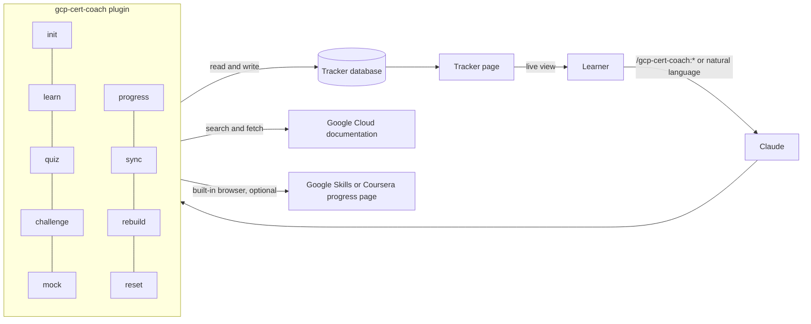
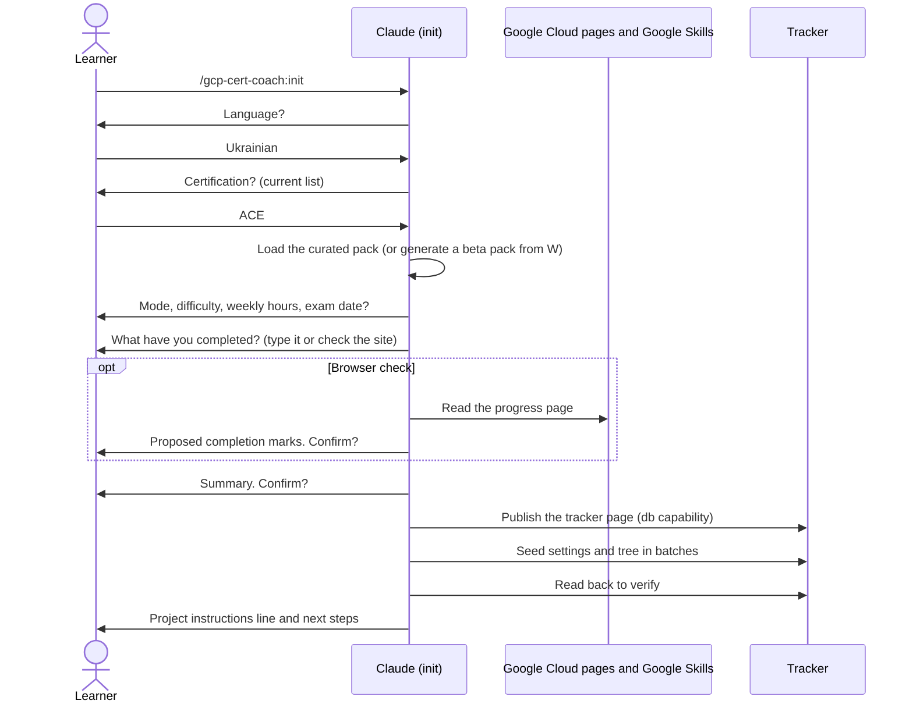
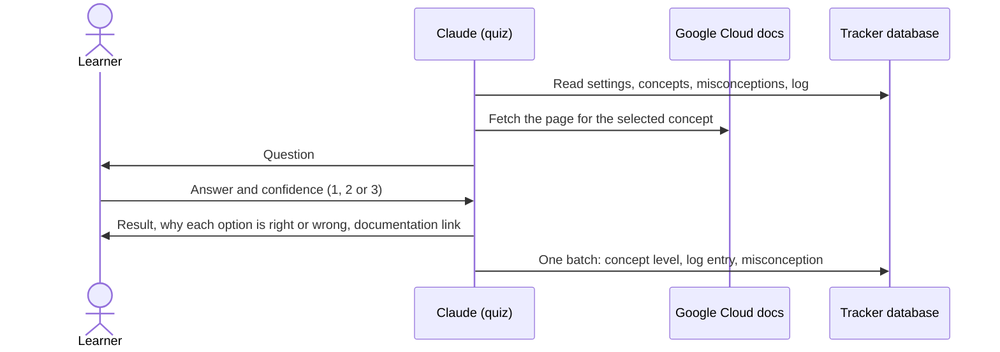
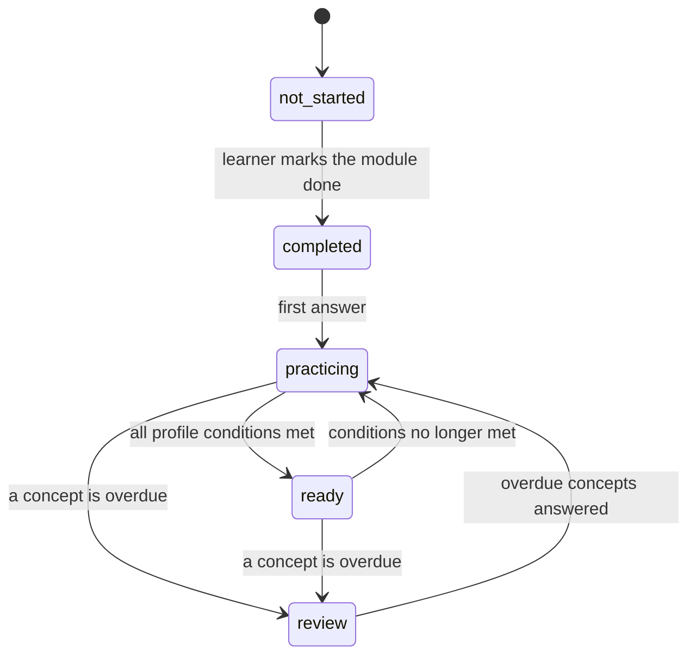
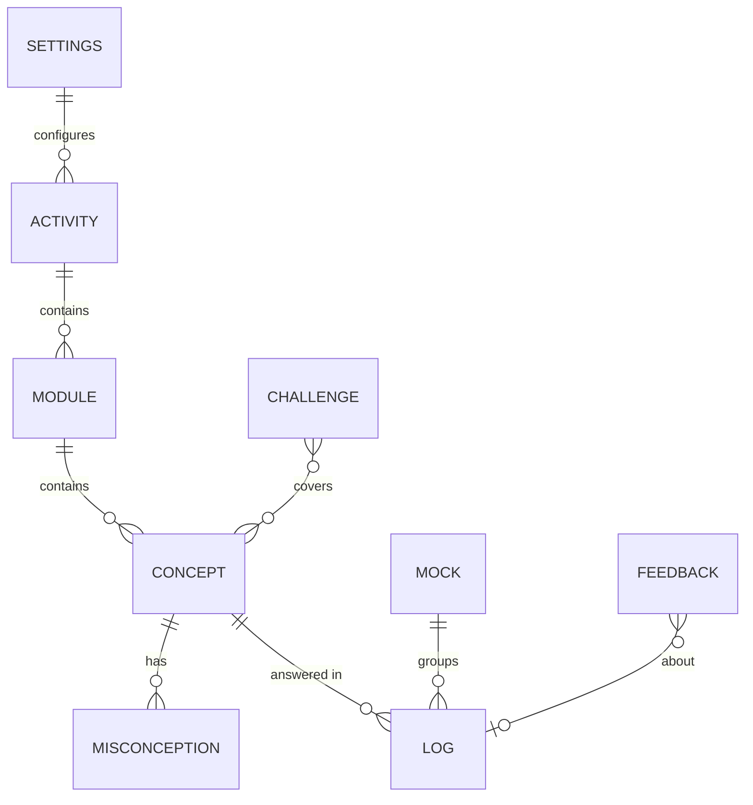

# GCP Certification Coach

A Claude plugin that coaches you for Google Cloud certifications. It builds a skill tree from the official Google Skills learning path, quizzes you only on what you have completed, grounds every explanation and answer in public Google Cloud documentation, and tracks mastery in a live tracker page that rewards honest, consistent knowledge instead of lucky guesses.

Works in claude.ai chat, the Claude desktop app and Cowork. The first curated pack is **Associate Cloud Engineer (ACE)**; any other Google Cloud certification works through an auto-generated pack marked **beta**.

> Not affiliated with or endorsed by Google or Anthropic. "Google Cloud" and certification names are used descriptively. This plugin does not guarantee passing an exam.

## Contents

- [Who it is for](#who-it-is-for)
- [Features](#features)
- [Install](#install)
- [Quick start](#quick-start)
- [Commands](#commands)
- [Modes and difficulty](#modes-and-difficulty)
- [How mastery works](#how-mastery-works)
- [How it fits together](#how-it-fits-together)
- [Usage and cost](#usage-and-cost)
- [Privacy and data](#privacy-and-data)
- [FAQ](#faq)
- [Roadmap](#roadmap)
- [Contributing](#contributing)
- [License](#license)

## Who it is for

| You are | You get |
|---|---|
| Following the official course on Google Skills or Coursera | Quizzes on exactly what you just finished, and a clear signal when a module is really learned |
| An engineer who wants the certificate | The exam-guide topics the course does not cover, realistic 50-question mock exams, a booking recommendation |
| Studying in bursts | Pause and resume, decay of what you have not reviewed, a warm-up after long breaks, a plan with an estimated finish date |

## Features

- **Skill tree from the official learning path**: activities (courses and skill badges) → modules → concepts, mapped to exam-guide sections with official weights.
- **Exam-guide gaps** (Full exam mode): 16 ACE topics the path covers only in passing, each with official documentation links.
- **Exam-style quizzes** in six formats (scenario, multi-select, command, explain, choose a service, why it is wrong), only on completed modules, never repeating a question, always explaining every option with a documentation link.
- **Confidence ratings** (1 guess or unsure, 2 fairly confident, 3 sure; hedged answers such as "probably B" count as 1): a correct guess earns nothing, a confident mistake is recorded as a misconception and asked again with new wording until fixed.
- **Pre-tests** before a module (no level change), **hands-on challenges** in your own project with evidence-based review and a bonus, **mock exams** with a red, amber or green recommendation.
- **Live tracker page**: readiness ring, plan, review queue, section mastery, skill tree with statuses, misconceptions, calibration, mock history, recent answers.
- **Explanations in your language**; Google Cloud terms, commands and exam questions stay in English.
- **Maintenance commands**: sync with the live path and exam guide (diff, confirm, snapshot), rebuild the page without touching data, reset with a snapshot and a confirmation phrase.

## Install

**claude.ai or the Claude desktop app:** Customize → Plugins → **Add marketplace** → enter `olehsov/gcp-certification-coach` → install **GCP Certification Coach**.

**Claude Code** (for maintenance and testing):

```bash
claude plugin marketplace add olehsov/gcp-certification-coach
claude plugin install gcp-cert-coach@gcp-certification-coach
```

## Quick start

1. Create a Claude Project for one certification (for example "ACE prep").
2. In a chat inside it, run `/gcp-cert-coach:init`. Choose the explanation language, the certification, Course or Full exam mode, Standard or Hard difficulty, weekly hours and an optional exam date, and say what you already completed (or let Claude read your progress page in the desktop app's built-in browser).
3. Claude publishes your tracker and prints two lines for the Project instructions. Paste both:
   ```text
   GCP Cert Coach tracker: <link> (certification: ace)
   In this Project, use the gcp-cert-coach skills for every study request (explanations, quizzes, challenges, mock exams, progress).
   ```
   The first tells every chat where your tracker is; the second makes Claude use the coach's skills instead of answering from general knowledge.
4. Study the course, then use the commands: `/gcp-cert-coach:progress` ("I finished module 3 of course 2"), `/gcp-cert-coach:quiz`, `/gcp-cert-coach:learn`, `/gcp-cert-coach:challenge`, `/gcp-cert-coach:mock`. Typing the command is the most reliable way to start a skill; plain requests work too inside the Project.

## Commands

Typing the command is the most reliable; inside the Project (with both instruction lines) you can also just say what you want.

| Command | Say for example | Writes to the tracker |
|---|---|---|
| `/gcp-cert-coach:init` | "Set up the coach for ACE" | everything (creation) |
| `/gcp-cert-coach:learn` | "Explain Cloud NAT", "Break down this lab" | feedback only |
| `/gcp-cert-coach:quiz` | "Quiz me", "Pre-test on the next module" | concepts, log, misconceptions |
| `/gcp-cert-coach:challenge` | "Give me a hands-on challenge" | challenges, concepts |
| `/gcp-cert-coach:mock` | "Mock exam" | mocks, log, concepts (one batch at the end) |
| `/gcp-cert-coach:progress` | "I finished course 6", "Pause my plan", "What's my plan?" | modules, settings |
| `/gcp-cert-coach:sync` | "Check for course updates" | tree, settings (after confirmation) |
| `/gcp-cert-coach:rebuild` | "Update the tracker page" | page, settings |
| `/gcp-cert-coach:reset` | "Reset my progress" | snapshot, then levels and history |

Disagree with a question or have an idea? Say "this question is wrong" or "I'd like X to work differently"; Claude records it in your tracker's feedback list.

## Modes and difficulty

| | Course | Full exam |
|---|---|---|
| Tree | Learning path only | Path plus the "Exam guide gaps" activity |
| Readiness label | Course readiness | Exam readiness |
| Use it | While following the course | Before booking the exam |

| Requirement for a module to be **ready** | Standard | Hard |
|---|---|---|
| Module level | ≥ 75 | ≥ 85 |
| Concept coverage | ≥ 80% | 100% |
| Answers (pre-tests excluded) | ≥ 4 | ≥ 6 |
| On distinct days | ≥ 2 | ≥ 3 |
| Last answers correct with confidence ≥ fairly confident | 2 | 3 |
| Open misconceptions allowed | yes | no |
| Mock exam green | ≥ 75% once | ≥ 80% twice in a row |

Switch either one at any time from the tracker page or by asking.

## How mastery works

Each concept has a level from 0 to 100.

- **Correct:** level moves toward 100 by a fraction of the remaining gap: 15%, 25% or 35% for easy, medium or hard questions, times 0 (guess or unsure), 0.6 (fairly confident) or 1.0 (sure).
- **Wrong:** level drops by a fraction of the current level, small for an honest guess and largest for a confident mistake. Missing an easy question costs more than missing a hard one.
- **Daily gain cap:** at most 25 points per concept per day (20 in Hard), so one long evening does not count as durable knowledge.
- **Review and decay:** each concept comes back after 3, 7 or 14 days depending on its level (2, 5, 10 in Hard). Past that, it loses 3 points per week (5 in Hard). Paused time does not count.
- **Readiness** = the official section weights × the mastery of the modules mapped to each section; untouched modules count as 0.
- **Calibration** shows how often your "sure" answers are actually right.

Every constant, with the reason for its value, lives in [`scoring.yaml`](plugins/gcp-cert-coach/skills/init/assets/packs/ace/scoring.yaml) and is copied into your tracker, so tuning needs no code change.

## How it fits together



Setting up (`init`):



One quiz answer:



Module status:



Data model (one tracker per certification):



Design documents: [PRD](docs/PRD.md), [architecture](docs/ARCHITECTURE.md), [decision records](docs/adr/).

## Usage and cost

- Use Sonnet for quizzes and daily learning, and Opus for mock exams and hard topics.
- Start a new chat for each study session. All state lives in the tracker, so nothing is lost, and long threads make every turn slower and costlier.
- Quizzes cite the curated documentation links by default and fetch a page only when needed, which keeps sessions fast.
- When the tracker page falls behind the plugin, the coach and the page tell you; say "rebuild" to update it (your data is untouched).

## Privacy and data

- Your progress is stored only in a private artifact in your own Claude account. The plugin has no servers, no connectors and no telemetry.
- Stored: levels, answers to practice questions, misconceptions, mock results, challenge summaries, settings, feedback notes. Not stored: names, emails, Google Cloud project ids, billing ids or raw command output.
- Fetched: public Google Cloud documentation, certification and exam-guide pages, the Google Skills learning path; optionally your progress page in the desktop app's built-in browser (completion state only, confirmed before writing; you sign in yourself).
- Claude never runs commands in your Google Cloud project. Redact project ids and emails before pasting challenge output.
- This repository contains no personal data; CI and git hooks check every change.

## FAQ

**Does it replace the course?** No. It tells you what you know after each module, finds what the course does not cover, and grounds explanations in documentation. Course materials are never copied.

**Where do questions come from?** Claude writes original questions from the official documentation for each concept and links the page used for the answer key. If you think a key is wrong, say so: Claude re-checks it and records feedback.

**Can I use Coursera instead of Google Skills?** Yes. The courses are the same; skill badges exist only on Google Skills and can be left uncompleted. Module numbers follow Google Skills, which can differ from Coursera (for ACE, course 2 has an extra introduction module first), so when you type "course 2 module 3" the coach always asks "Do you mean course 2 <title>, module <title>?" and writes nothing until you say yes; if the titles are wrong, type the module and course names instead.

**What does "ready" mean?** All the profile conditions in the table above, not a single number. Course readiness is not exam readiness; switch to Full exam mode before booking.

**Can I use it in another language?** Yes. Choose the language at setup; product names, commands and questions stay in English like the exam.

**What if the course changes?** Run `/gcp-cert-coach:sync`: it shows a diff, takes a snapshot, keeps progress on renamed items and archives removed ones.

**Does it work in Claude Code?** Commands load, but the tracker page needs an artifact with a database, which is available in claude.ai chat, the desktop app and Cowork.

## Roadmap

- **v2:** a question-verification agent (Cowork and Claude Code) that checks answer keys against documentation; optional Google Developer Knowledge MCP connector; more curated packs (Professional Cloud Architect, Professional Data Engineer).
- **v3:** adapters for other agents and chat products with a file-based progress fallback; submission to Anthropic's plugin directory.

## Contributing

See [CONTRIBUTING.md](CONTRIBUTING.md): adding a certification pack, running evals, privacy rules, commit style. Changes are listed in the [CHANGELOG](CHANGELOG.md).

## License

Code: [MIT](LICENSE). Content (certification packs, cheat sheets, documentation): [CC BY 4.0](LICENSE-CONTENT). Course and certification titles are names of third-party works used as factual references. Not affiliated with or endorsed by Google or Anthropic.
