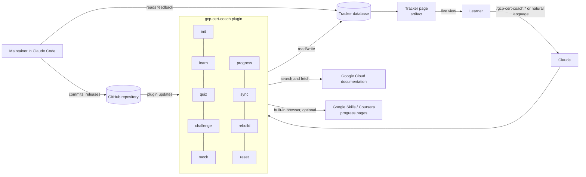
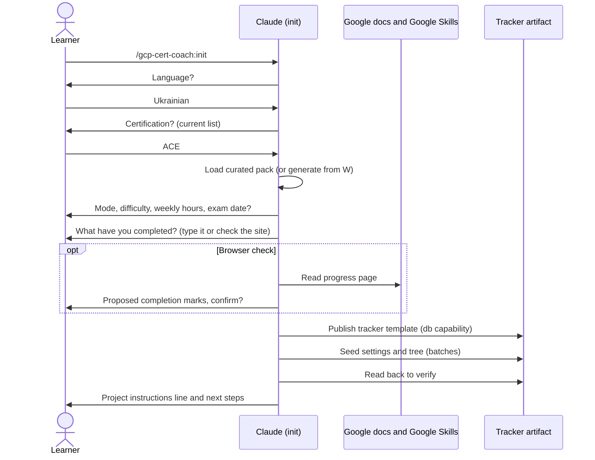
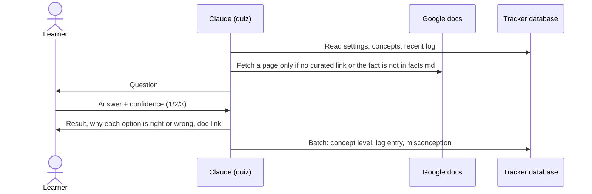
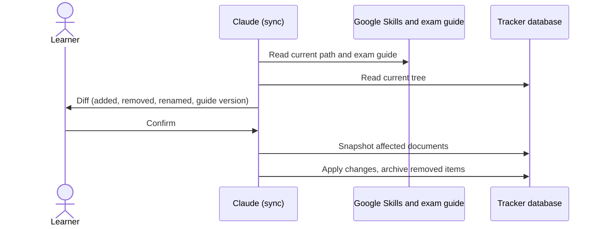
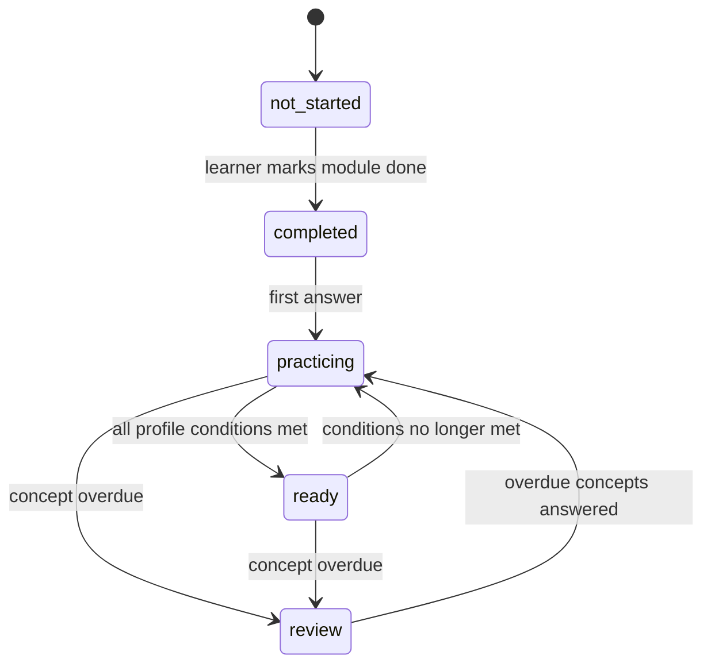
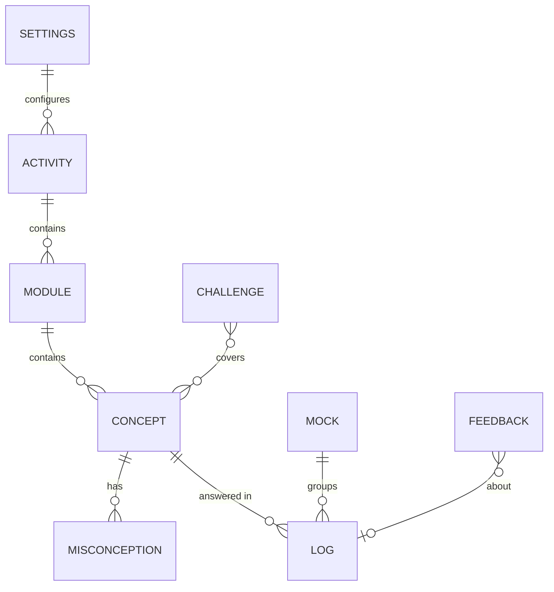

# Architecture: GCP Certification Coach

> Read with [PRD.md](PRD.md). Decisions are recorded in [adr/](adr/).

## Contents

1. [Overview](#1-overview)
2. [Surfaces](#2-surfaces)
3. [Repository layout](#3-repository-layout)
4. [Components](#4-components)
5. [Tracker](#5-tracker)
6. [Mastery and readiness model](#6-mastery-and-readiness-model)
7. [Certification packs](#7-certification-packs)
8. [Skill contracts](#8-skill-contracts)
9. [Cross-cutting rules](#9-cross-cutting-rules)
10. [Diagrams](#10-diagrams)

---

## 1. Overview



The plugin is instructions and content. All learner state lives in one tracker artifact per certification. Documentation is fetched at runtime from public Google Cloud pages.

## 2. Surfaces

| Surface | Learner use (v1) | Notes |
|---|---|---|
| claude.ai chat (web, mobile) | Yes | Skills and commands load as skills; artifacts and their database work |
| Claude desktop app | Yes | Same as chat, plus the built-in browser for progress checks |
| Cowork | Yes | Same capabilities; agents would load here in v2 |
| Claude Code | Maintenance only | Builds, validates, evaluates and releases the plugin; reads the `feedback` collection |

## 3. Repository layout

```
gcp-certification-coach/
├── .claude-plugin/
│   └── marketplace.json              # lists the plugin; repo root is the marketplace
├── plugins/
│   └── gcp-cert-coach/               # everything a user installs, nothing else
│       ├── .claude-plugin/
│       │   └── plugin.json
│       ├── skills/
│       │   ├── init/
│       │   │   ├── SKILL.md
│       │   │   ├── references/       # setup flow, tracker locating, browser progress check
│       │   │   └── assets/
│       │   │       ├── tracker.html  # tracker page template
│       │   │       └── packs/
│       │   │           └── ace/      # curated ACE pack (see §7)
│       │   ├── learn/       SKILL.md · references/ (explanation format, lab breakdown, cheat sheets)
│       │   ├── quiz/        SKILL.md · references/ (question formats, scoring, selection)
│       │   ├── challenge/   SKILL.md · references/ (challenge format, verification)
│       │   ├── mock/        SKILL.md · references/
│       │   ├── progress/    SKILL.md · references/ (browser progress check, plan)
│       │   ├── sync/        SKILL.md · references/
│       │   ├── rebuild/     SKILL.md · references/ (migrations)
│       │   └── reset/       SKILL.md
│       ├── assets/
│       │   └── icon.png                  # original plugin icon (no third-party marks), referenced by plugin.json
│       ├── README.md
│       └── LICENSE
├── docs/
│   ├── PRD.md
│   ├── ARCHITECTURE.md
│   └── adr/
├── evals/                            # cases for `claude plugin eval`
├── scripts/
│   ├── check-privacy.sh              # generic patterns + personal denylist outside the repo
│   ├── privacy-allowlist.txt         # narrowly scoped false-positive rules, each commented
│   ├── setup-hooks.sh                # git config core.hooksPath .githooks (idempotent)
│   └── build-zip.sh                  # upload zip of the plugin folder for claude.ai
├── .githooks/
│   ├── pre-commit                    # privacy check + gitleaks on staged files
│   └── pre-push                      # gitleaks on pushed commits, privacy check, plugin validate
├── .github/workflows/validate.yml    # plugin validate + privacy check + gitleaks
├── .gitignore                        # zips, eval run outputs, transcripts, .env*, *.local.*
├── CLAUDE.md
├── README.md
├── CHANGELOG.md
├── CONTRIBUTING.md
├── LICENSE                           # MIT
└── LICENSE-CONTENT                   # CC BY 4.0
```

Rules: only `plugin.json` inside `.claude-plugin/`; one folder per skill named exactly as the skill's `name`; references one level deep; no `bin/` inside the plugin.

## 4. Components

| Skill | Purpose | Writes to tracker |
|---|---|---|
| `init` | Choose certification, build tree, settings, initial progress, publish tracker | Everything (creation) |
| `learn` | Explain topics and labs, grounded in documentation | `feedback` only |
| `quiz` | Exam-style questions, pre-tests, warm-ups; scoring | `concepts`, `log`, `misconceptions`, `settings.paused` |
| `challenge` | Hands-on tasks without step-by-step guidance; verification; bonus | `challenges`, `concepts`, `misconceptions` |
| `mock` | Full mock exam with section breakdown and recommendation | `mocks`, `concepts`, `log` (one batch at the end) |
| `progress` | Mark modules complete (manual or browser), pause, change settings, status and plan | `modules`, `settings` |
| `sync` | Re-read path and exam guide, diff, apply after confirmation | tree collections, `settings` |
| `rebuild` | Republish tracker page from the current template; migrate schema | page, `settings.schemaVersion` |
| `reset` | Archive progress, confirm, reset levels | `snapshots/*`, `concepts`, `log`, `misconceptions` |

## 5. Tracker

### 5.1 Publishing

- `init` publishes `assets/tracker.html` as a new artifact with `capabilities: {"db": {}}` and default access rules (owner reads and writes).
- Title: `<Short cert name> Cert Coach`, for example `ACE Cert Coach`.
- After publishing, `init` seeds the database through the artifact data tool in batches of at most 50 writes, then reads back one page of each collection to verify.
- The page never hardcodes learner data; its first frame is a designed empty state that fills from the database.

### 5.2 Database schema (`schemaVersion: 1`)

All documents are flat JSON. Timestamps are ISO 8601 UTC strings. Dates (`YYYY-MM-DD`) use the learner's local date.

**`meta/settings`** (single document)

| Field | Type | Description |
|---|---|---|
| `schemaVersion` | int | Database schema version (1) |
| `pluginVersion` | string | Plugin version that last wrote the settings |
| `templateVersion` | string | Plugin version the tracker page was published from (set by `init` and `rebuild`); missing means `pluginVersion`. Added in 0.2.0, schema stays 1 |
| `latestPluginVersion` | string | Highest plugin version that has touched the tracker; the page compares it with its own embedded version and shows an "outdated" notice. Added in 0.2.0 |
| `certId`, `certName`, `certShortName` | string | e.g. `ace`, `Associate Cloud Engineer`, `ACE` |
| `packSource` | `curated` \| `generated` | Generated packs are labeled `beta` in the UI |
| `examGuide` | object | `{version, url, sections: [{id, name, weight}]}` |
| `path` | object | `{url, title, providers: {googleSkills, coursera}}` |
| `mode` | `course` \| `full` | Full adds the exam-guide gaps activity |
| `difficulty` | `standard` \| `hard` | Selects the threshold profile |
| `language` | string | BCP-47 tag for explanations and UI, e.g. `en`, `uk` |
| `ui` | object | Translated UI strings; missing keys fall back to English |
| `paceHoursPerWeek` | number | Default 7 |
| `startDate` | date | Day of `init` |
| `examDate` | date \| null | Optional |
| `paused` | `{since: date}` \| null | Active pause |
| `pausedDaysTotal` | int | Sum of completed pauses, excluded from decay and plan |
| `pauseHistory` | array | Completed pauses `[{since, until}]` (dates). Lets skills and the page subtract exactly the paused days that fall after a concept's `lastReviewed` (§6.5). Added during the v0.1.0 build |
| `lastSyncAt` | timestamp | Last successful `sync` or `init` |
| `scoring` | object | Full constant set from §6, with `rationale` strings |
| `createdAt`, `updatedAt` | timestamp | |

**`activities/{activityId}`** — courses, skill badges and the gaps block

| Field | Type | Description |
|---|---|---|
| `order` | int | Position in the path |
| `kind` | `course` \| `skill_badge` \| `gaps` | |
| `title` | string | Official title |
| `hours` | number | Estimated duration from the provider |
| `optional` | bool | Mirrors the path; `gaps` is shown only in Full mode |
| `urls` | object | `{googleSkills, coursera}` when known |
| `archived` | bool | Set by `sync` when removed from the path |

**`modules/{moduleId}`**

| Field | Type | Description |
|---|---|---|
| `activityId`, `order`, `title` | | |
| `sections` | string[] | Exam-guide objective ids, e.g. `["3.1", "4.1"]` |
| `weight` | `core` \| `support` | Support counts half in readiness |
| `examRelevant` | bool | False for intros, summaries, course resources |
| `hours` | number \| null | If the provider lists it |
| `labs` | string[] | Lab titles inside the module (informational; added during the v0.1.0 build) |
| `completed` | bool | Marked by the learner |
| `completedAt` | date \| null | |
| `archived` | bool | |

**`concepts/{conceptId}`** — submodules; the unit of questioning and mastery

| Field | Type | Description |
|---|---|---|
| `moduleId`, `order`, `title` | | |
| `docUrls` | string[] | Official documentation pages (curated or found at runtime) |
| `level` | number | 0–100, stored base level (see §6.5) |
| `answers`, `correct` | int | Counts excluding pre-tests |
| `recent` | array | Last 5 `{date, correct, confidence}` |
| `days` | date[] | Distinct answer dates, most recent 10 |
| `lastReviewed` | timestamp \| null | |
| `bonus` | number | Challenge bonus already applied (for audit) |
| `archived` | bool | |

**`log/{logId}`** — one document per answered question (`logId` = timestamp + random suffix)

| Field | Type | Description |
|---|---|---|
| `ts` | timestamp | |
| `kind` | `quiz` \| `pretest` \| `warmup` \| `mock` | |
| `conceptId`, `moduleId` | string | |
| `format` | `scenario` \| `multi_select` \| `command` \| `explain` \| `choose_service` \| `why_wrong` | |
| `difficulty` | `easy` \| `medium` \| `hard` | |
| `confidence` | 1 \| 2 \| 3 | 1 guess or unsure (hedged answers), 2 fairly confident, 3 sure |
| `question` | string | Full question text including options |
| `answerKey` | string | Correct option(s) |
| `given` | string | Learner's answer |
| `correct` | bool | |
| `docUrl` | string | Source used for the answer key |
| `levelBefore`, `levelAfter` | number | Null for pre-tests |
| `misconceptionId` | string \| null | |
| `mockId` | string \| null | |

**`misconceptions/{id}`**

`conceptId`, `statement` (the wrong belief, in English, one sentence), `status` (`open` \| `resolved`), `createdAt`, `resolvedAt`, `consecutiveRefutations` (int).

**`mocks/{mockId}`**

`ts`, `questions`, `correct`, `percent`, `bySection` (`{sectionId: {questions, correct}}`), `durationMinutes`, `verdict` (`red` \| `amber` \| `green`).

**`challenges/{id}`**

`ts`, `title`, `conceptIds`, `status` (`assigned` \| `submitted` \| `passed` \| `partial` \| `failed`), `score` (0–1), `bonusApplied`, `reviewSummary` (Claude's summary; never raw command output, which can contain project ids).

**`feedback/{id}`**

`ts`, `source` (`learner` \| `claude`), `kind` (`wrong_question` \| `bug` \| `improvement`), `text` (no personal data), `logId` (optional), `pluginVersion`, `status` (`new` \| `triaged` \| `done`).

**`snapshots/{snapshotId}`** and **`snapshots/{snapshotId}/<collection>`**

Created by `reset`, before a destructive `sync`, before a `rebuild` migration and before a restore. Ids: `reset-<YYYYMMDD-HHMM>`, `sync-<YYYYMMDD-HHMM>`, `migration-<YYYYMMDD-HHMM>`, `restore-<YYYYMMDD-HHMM>`. Metadata: `ts`, `reason`, `pluginVersion`, `certId`, `trackerTitle`, `status` (`writing` then `complete`), `collections` (`{name: {rows, chunks}}`), `scope`. The documents themselves live in `snapshots/<id>/chunks/<collection>-<NNN>` as `{collection, chunk, rows: [{id, data}]}` with full copies (at most 100 rows per chunk, 25 for `log`), so a snapshot is restorable in any chat without conversation context. A destructive step starts only after `status: "complete"`. See `skills/reset/references/snapshots.md` (identical copies in sync and rebuild).

### 5.3 Locating the tracker

Every skill except `init` locates the tracker in this order:

1. A line in the current context (Project instructions or the conversation) of the form:
   `GCP Cert Coach tracker: <artifact URL> (certification: <certId>)`
2. The learner's artifact list, filtered by titles ending in `Cert Coach`. One match → use it. Several → ask which certification. None → offer `init`.
3. If the artifact data tool or the database is unavailable, continue the learning activity, say clearly that progress is not being saved, and suggest opening the conversation in claude.ai or the desktop app. In this read-only mode a skill uses a tracker export from the conversation when one is present and shows the write batch it would have made (as JSON), labeled "not saved". Destructive skills show the full plan (snapshot first, archive rather than delete) and apply nothing.

`init` ends by printing the line from step 1 plus a second line, `In this Project, use the gcp-cert-coach skills for every study request (explanations, quizzes, challenges, mock exams, progress).`, and recommending one Claude Project per certification. The second line counters under-triggering of skills on plain study requests (see `evals/RESULTS.md`, trigger accuracy).

### 5.4 Page

Sections, top to bottom:

1. **Header:** certification name, `beta` badge for generated packs, readiness ring labeled "Course readiness" (Course mode) or "Exam readiness" (Full mode), counts (modules completed, concepts mastered = exam-relevant concepts at or above the profile's module-ready level, answers), mode and difficulty toggles, pause state.
2. **Plan:** remaining hours, weekly pace, estimated finish date (or exam date), on-track indicator.
3. **Exam-guide sections:** mastery bar and official weight for each section.
4. **Review queue:** top 7 items by priority (§6.6).
5. **Skill tree:** activities → modules (completion, level, coverage, status chip) → concepts (level, answers).
6. **Misconceptions:** open items first.
7. **Calibration:** accuracy of "sure" answers, overall accuracy.
8. **Mock exams:** history with verdicts.
9. **Recent answers:** last 15 log entries.
10. **Notices:** "not synced for 30 days", "database unavailable". Rendered at the top of the page, above the header, so they are seen first; listed last here because they are usually empty.

The skill tree explains its numbers (module level includes untested concepts; coverage; the `level · correct/answers` concept format) with a help line and tooltips, and a collapsible "How levels work" note follows it. The page embeds `PLUGIN_VERSION`; when `settings.latestPluginVersion` is higher it shows a notice asking the learner to say "rebuild". A footer shows the plugin version (the `PLUGIN_VERSION` constant in the template) and the non-affiliation disclaimer. The template's `<title>` is `GCP Cert Coach`; `init` and `rebuild` replace it with `<certShortName> Cert Coach`. Calibration also shows the share of guesses (confidence 1).

Mode and difficulty toggles write `meta/settings` from the page (the owner has write access). Everything else is written by Claude. The page subscribes once per collection with `onSnapshot`, uses a 10-second load timeout, and follows the artifact page contract (theme tokens, phone width, no external hosts except allowed CDNs and Google Fonts).

## 6. Mastery and readiness model

All constants are stored in `settings.scoring` with a rationale string. Values below are defaults for v1.

### 6.1 Answer update

Let `L` be the concept's effective level (§6.5), `d` the difficulty and `c` the confidence.

- Correct: `L' = L + α[d] · m[c] · (100 − L)`
- Wrong: `L' = L − β[c][d] · L`
- Then apply the daily gain cap (§6.3) and clamp to `[0, 100]`. Round to one decimal.

| Constant | easy | medium | hard | Rationale |
|---|---|---|---|---|
| `α` gain fraction | 0.15 | 0.25 | 0.35 | Harder questions are stronger evidence of mastery |

| Confidence | `m` (correct) | `β` easy | `β` medium | `β` hard | Rationale |
|---|---|---|---|---|---|
| 1 guess or unsure | 0.0 | 0.10 | 0.08 | 0.05 | A guess proves nothing; an honest "don't know" is barely penalized, so honesty is safe |
| 2 fairly confident | 0.6 | 0.25 | 0.20 | 0.15 | Partial certainty earns partial credit |
| 3 sure | 1.0 | 0.40 | 0.35 | 0.30 | Confident errors are the most dangerous on the exam |

Missing an easy question costs more than missing a hard one because it signals a basic gap.

### 6.2 Misconceptions

- A wrong answer with confidence 1 never creates a misconception, and hedged answers ("probably B") count as confidence 1. A wrong answer with confidence 3 always creates a misconception. A wrong answer with confidence 2 creates one when the explanation identifies a specific wrong belief.
- A later question on the same concept, with different wording, targets the misconception.
- Resolved after 2 consecutive correct answers on that concept with confidence ≥ 2. A wrong answer resets the counter.

### 6.3 Profiles

| Constant | Standard | Hard | Rationale |
|---|---|---|---|
| `dailyGainCap` per concept | 25 | 20 | Durable knowledge needs more than one session |
| Review interval days for level `<60 / <80 / ≥80` | 3 / 7 / 14 | 2 / 5 / 10 | Expanding intervals; Hard reviews sooner |
| `decayPerWeekOverdue` | 3 | 5 | Models forgetting after a missed review |
| Module ready: module level ≥ | 75 | 85 | |
| Module ready: concept coverage ≥ | 80% | 100% | Coverage = concepts with ≥1 answer / exam-relevant concepts |
| Module ready: answers ≥ | 4 | 6 | Across the module's concepts, excluding pre-tests |
| Module ready: distinct days ≥ | 2 | 3 | Knowledge survived at least one night |
| Module ready: last N module answers correct with confidence ≥ 2 | 2 | 3 | Recent performance, not history |
| Module ready: open misconceptions allowed | yes | no | |
| Mock green | ≥ 75% once | ≥ 80% twice in a row | |
| Mock amber | 60–74% | 65–79% | |
| Mock red | < 60% | < 65% | |

### 6.4 Statuses (module)

`not_started` → `completed` (marked by learner) → `practicing` (≥1 answer) → `ready` (all §6.3 conditions) ; any status with answers becomes `review` when the module's most overdue concept passes its review interval. `ready` drops back to `practicing` when conditions stop holding.

### 6.5 Effective level and decay

`effectiveLevel = level − decayPerWeekOverdue × weeksOverdue`, floored at 0, where `weeksOverdue` counts days past the review interval since `lastReviewed`, minus paused days (the active pause plus `pauseHistory` entries overlapping that span), divided by 7. Skills compute the effective level before every update and store the result as the new `level`. The page computes it for display.

### 6.6 Selection priority for quiz questions

From exam-relevant concepts in completed, non-archived modules (plus gaps in Full mode). Gap topics are seeded in both modes and shown only in Full mode, so switching mode needs no reseed; in Full mode their concepts are eligible without being marked completed. A concept is due when `overdue >= 0`; a module's `review` status uses `overdue > 0`.

1. Concepts with an open misconception (new wording each time).
2. Concepts never asked.
3. Concepts due or overdue for review, most overdue first.
4. Lowest effective level.
5. Skip concepts answered correctly with confidence 3 inside their review interval.

Interleave across modules; do not serve more than 2 consecutive questions from one module. Never repeat a question text found in `log` for that concept. Default session: 5 questions. Mix formats: mostly `scenario` and `multi_select`; at least one other format per 5 questions when the concept allows.

### 6.7 Special activities

| Activity | Effect |
|---|---|
| Pre-test (5 questions on the next uncompleted module) | Logged with `kind: pretest`; no level change; after the module is completed, the same concepts are re-tested to show improvement |
| Warm-up (5 questions on highest-level concepts) | Runs as the first quiz after a pause of more than 7 days; scored normally |
| Challenge | Bonus `15 + 10 × score` to each linked concept when `score ≥ 0.5`, subject to the 100 cap and not to the daily cap; resolves linked misconceptions when `score = 1`; does not count toward answers or days |
| Mock exam | 50 questions across sections by official weight, drawn from every exam-relevant module of the current mode whether completed or not (FR-1 applies to quizzes, not mocks); levels of every tested concept updated with normal rules at the end in one batch, or consecutive batches when the data tool limits batch size (the `mocks` document last); verdict per §6.3 |

### 6.8 Readiness

- Module level = mean of effective levels of its exam-relevant concepts.
- Section score = weighted mean of module levels for modules mapped to that section (core 1.0, support 0.5). Modules mapped to several sections count in each.
- Readiness = Σ(section weight × section score) / 100, using only modules in the current mode. Untouched modules count as 0.

### 6.9 Plan

The formula lives once, in `progress/references/plan-estimate.md` (copy in `init`); the tracker page, `progress` and the seed script follow it.

- Remaining hours = hours of uncompleted required activities (module hours if known, else activity hours pro-rated by module count) + Full mode gap estimate (1 hour per gap topic) + practice buffer (20% of total required hours, minus practice already done at 3 minutes per logged answer).
- Weeks = remaining hours / `paceHoursPerWeek`. Estimated finish = today + weeks + active pause days.
- With `examDate`, show required pace and on-track status instead.

## 7. Certification packs

### 7.1 Curated pack layout (`skills/init/assets/packs/<certId>/`)

| File | Content |
|---|---|
| `pack.yaml` | `certId`, names, exam-guide url and version, sections with weights, path url and providers, pack version, last verified date |
| `path.yaml` | Activities → modules → concepts with order, kind, hours, optional flags, sections, weight, `examRelevant`, documentation URLs per concept where known |
| `gaps.yaml` | Exam-guide gap topics → concepts, sections, documentation URLs |
| `README.md` | How the pack was built, sources, verification date |

Content rules: titles and structure only from public course outlines; descriptions written originally; documentation links only to public Google pages.

Identifiers and sources:

- Activities: `c<N>` for courses and `b<N>` for skill badges, numbered in Google Skills path order. Modules: `<activityId>-m<N>`. Concepts: `<moduleId>-k<N>`. Gap topics: `g<NN>`, their concepts `g<NN>-k<N>`. The gaps activity id is `gaps`.
- Module numbering follows the Google Skills path, which can differ from Coursera (for ACE, course 2 starts with a "Course Introduction" module there). Numbers typed by the learner are resolved to ids in Google Skills order and are never written without the question "Do you mean course N <title>, module(s) <titles>?"; a no leads to typed names matched by title, then a second confirmation.
- Hours are the durations stated on Google Skills (ACE total 58.75 h); a gap topic counts 1 h.

### 7.2 Generated pack (`packSource: generated`, beta)

1. Find the certification page and exam guide on `cloud.google.com/learn/certification`.
2. Find the matching Google Skills certification learning path; read activities and module outlines with the built-in browser (the pages render with JavaScript). Without a browser, ask the learner to paste the outline or to open the chat in the desktop app.
3. Map modules to exam-guide objectives; build the gaps list by comparing objectives with module topics.
4. Show the generated tree for confirmation before publishing.

## 8. Skill contracts

Each `SKILL.md` must contain: purpose, when to use and when not to use, preconditions, a step checklist, output format, failure handling, and links to its reference files.

### init
- Trigger: start preparing, set up, choose a certification.
- Steps: ask language → list current certifications → choose → load curated pack or generate → choose mode, difficulty, pace, optional exam date → initial progress (manual or browser) → show summary for confirmation → publish tracker → seed database → verify read-back → print the Project instructions line and next steps.
- Refuses to create a second tracker for a certification that already has one unless the learner confirms.
- Seeds with `scripts/build_seed.py` when the script can run; otherwise (no tool to run it, a script error, PyYAML unavailable) builds the same batches from the pack files (see `init/references/seeding.md`) and says which path it used. The script's summary carries the plan estimate (§6.9) that init quotes before confirmation.

### learn
- Trigger: explain, how does X work, break down this lab.
- Explanation format: what it is, how it works, when to use, alternatives, best practices, exam angle, common traps, documentation links. Lab format: per step what, why, alternatives, production practice.
- Never reproduces course text the learner pastes beyond short quotes needed to reference a step.

### quiz
- Trigger: quiz me, test me, practice questions, pre-test.
- Steps: locate tracker → read settings, completed modules, their concepts and open misconceptions (selective reads, never the whole collections), then the last 50 log entries of the selected concepts → auto-resume if paused (warm-up if pause > 7 days) → plan the whole session once (§6.6) → for each question: show it under the header `Question N of M · <difficulty>` only (no concept, module or section name), read the answer and confidence (1/2/3; hedges count as 1; ambiguity is asked about, see `quiz/references/answer-parsing.md`), reveal the result, explain every option, cite the curated documentation link → write one batch → continue → end with session summary and module status changes.

### challenge
- Trigger: give me a challenge, hands-on task.
- Steps: pick completed concepts → task with goal and constraints, no step list → ask for a step narrative and outputs of named verification commands (screenshots optional) → evaluate against documentation → score 0–1 with per-requirement findings → write batch.
- Reminds the learner to remove project ids or personal data from pasted output; stores only a summary.
- Without a Google Cloud project, offers a design challenge (the learner describes the architecture and the commands they would run) with the score capped at 0.5.

### mock
- Trigger: mock exam, practice exam.
- 50 questions weighted by sections; one at a time under the header `Question n of 50 · <difficulty>`; answer key revealed only at the end; confidence collected per question; one write batch at the end; section breakdown, verdict, weakest concepts, next steps.

### progress
- Trigger: I finished module X, status, plan, pause, change mode or difficulty, check my progress on the site.
- Browser check flow per PRD FR-9; always confirm before writing.

### sync
- Trigger: check for updates to the path or exam guide.
- Plan → diff (added, removed, renamed activities, modules, concepts; exam-guide version) → confirm → complete snapshot of affected data (§5.2) → apply (new items level 0, renamed items keep data, removed items archived) → update `lastSyncAt`.

### rebuild
- Trigger: update the tracker page, the tracker looks outdated.
- Read current page and settings → migrate data if `schemaVersion` is older (migrations listed in `references/`) → republish template to the same URL without changing data → set `templateVersion` and `latestPluginVersion`. At the same version it answers "already up to date, republish anyway?".

### reset
- Trigger: reset my progress, start over.
- Name the tracker (title and certification) → show what will be reset → complete snapshot with full copies (§5.2) → explicit confirmation phrase → reset concept levels, log and misconceptions; keep tree, settings and completion marks unless the learner asks to clear them too. Mocks, challenges, feedback and earlier snapshots are kept. The confirmation phrase is `reset <certShortName> progress`.
- Restore ("restore my progress from the last snapshot"): list complete snapshots → show the effect → snapshot the current state → phrase `restore <certShortName> progress` → write rows back from the snapshot chunks only, never from the conversation → read back and compare counts.

## 9. Cross-cutting rules

- **Language:** see ADR 0007.
- **Grounding:** see ADR 0005, amended by ADR 0010. Curated concept `docUrls` and `facts.md` first; fetch on demand (at most one fetch per quiz question, two per explanation). Prefer `cloud.google.com/*/docs` and `docs.cloud.google.com`. Never use course materials as a source. Numeric facts live once in `references/facts.md` (identical copies in learn, quiz, mock and challenge).
- **Writes:** one batch per answer; pin updates with the last-read document version; on a version conflict, re-read and redo once.
- **Privacy:** never store names, emails, project ids, billing ids or raw command output; ask learners to redact pasted output.
- **Feedback:** when the learner disputes a question or suggests a change, write a `feedback` document and say it was recorded.
- **Failure messages:** say what failed, what was or was not saved, and what to do next.

## 10. Diagrams

### 10.1 `init`



### 10.2 One quiz answer



### 10.3 `sync`



### 10.4 Module status



### 10.5 Data model


