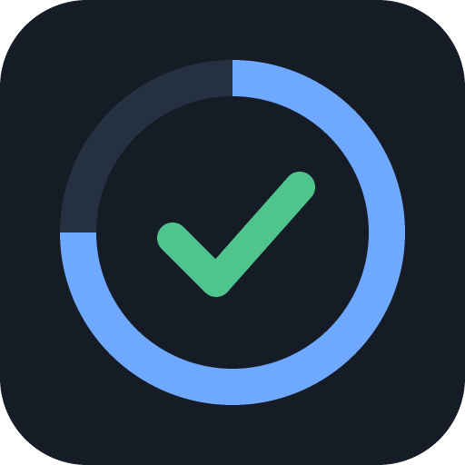

# GCP Certification Coach



GCP Certification Coach turns Claude into a study coach for Google Cloud certifications. It builds a skill tree from the official Google Skills learning path, explains topics and labs with links to public Google Cloud documentation, runs exam-style quizzes only on the modules you have completed, and measures readiness with a mastery model that rewards honest, consistent knowledge instead of lucky guesses. Progress lives in a private tracker page in your Claude account.

Not affiliated with or endorsed by Google or Anthropic.

## Install

On claude.ai or in the Claude desktop app: **Customize → Plugins → Add marketplace**, enter `olehsov/gcp-certification-coach`, then install **gcp-cert-coach** (GCP Certification Coach).

In Claude Code, inside a session:

```text
/plugin marketplace add olehsov/gcp-certification-coach
/plugin install gcp-cert-coach@gcp-certification-coach
```

or from a shell:

```bash
claude plugin marketplace add olehsov/gcp-certification-coach
claude plugin install gcp-cert-coach@gcp-certification-coach
```

The tracker page needs claude.ai chat, the Claude desktop app or Cowork; Claude Code is for maintaining the plugin.

## How to use it

Start with `/gcp-cert-coach:init` in a Claude Project used only for one certification, then talk naturally:

| Command | What it does |
|---|---|
| `/gcp-cert-coach:init` | Choose a certification, language, mode and difficulty; publish your tracker |
| `/gcp-cert-coach:learn` | Explain a service or break down a lab, with documentation links |
| `/gcp-cert-coach:quiz` | Exam-style questions on completed modules, with confidence ratings; pre-tests |
| `/gcp-cert-coach:challenge` | A hands-on task you do in your own project; evidence-based review |
| `/gcp-cert-coach:mock` | A 50-question mock exam with a red, amber or green recommendation |
| `/gcp-cert-coach:progress` | Mark modules done, check the site, pause, change settings, see your plan |
| `/gcp-cert-coach:sync` | Compare your tree with the live learning path and exam guide |
| `/gcp-cert-coach:rebuild` | Update the tracker page to the plugin's current version |
| `/gcp-cert-coach:reset` | Snapshot, confirm, then reset levels and history |

## Usage and cost

Use Sonnet for quizzes and daily learning and Opus for mock exams and hard topics. Haiku follows the skills but was the least reliable in our checks. Start a new chat per study session: the tracker keeps all state, and long threads get slower and costlier.

## What this plugin runs, sends and fetches

- **Runs:** `skills/init/scripts/build_seed.py`, locally in Claude's sandbox. It uses only the Python standard library, makes no network calls and builds the seed batches from the bundled certification pack. The plugin has no hooks, MCP servers, connectors or telemetry.
- **Fetches:** public Google Cloud documentation (`docs.cloud.google.com`, `cloud.google.com`), the public certification and exam-guide pages, and the Google Skills learning path page (`www.skills.google`). The tracker page loads its fonts from Google Fonts (`fonts.googleapis.com`).
- **Optional browser check:** if you ask, Claude opens your Google Skills or Coursera progress page in the Claude desktop app's built-in browser, reads only completion state, and writes nothing until you confirm. You sign in yourself.
- **Reads and writes:** only the database of your own private tracker artifact in your Claude account: levels, answers to practice questions, misconceptions, mock results, challenge summaries, settings and feedback notes. No names, emails, Google Cloud project ids or raw command output are stored.
- **Sends elsewhere:** nothing. Feedback you give is saved only in your own tracker.
- **Credentials:** none are requested, stored or handled. Your Google Cloud project is never touched: challenges are done by you, and Claude only reviews what you paste. Redact project ids and emails before pasting.

## License

Code is MIT (see `LICENSE` in this folder). Content, meaning the certification packs under `skills/init/assets/packs/` and the cheat sheets and references under `skills/*/references/`, is CC BY 4.0, as stated in [LICENSE-CONTENT](https://github.com/olehsov/gcp-certification-coach/blob/main/LICENSE-CONTENT) in the repository. Course and certification titles belong to their owners. Source and details: https://github.com/olehsov/gcp-certification-coach
